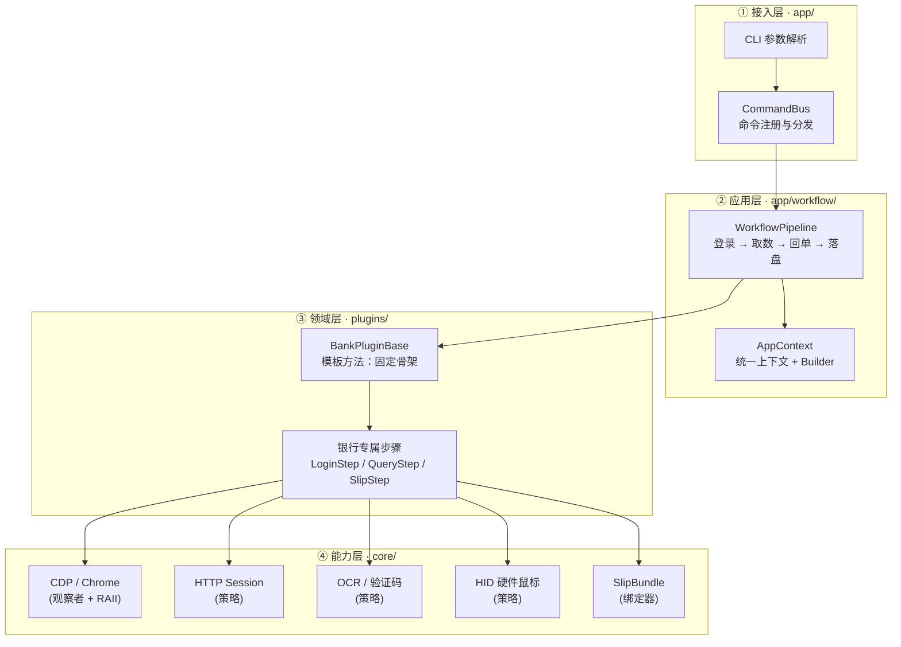
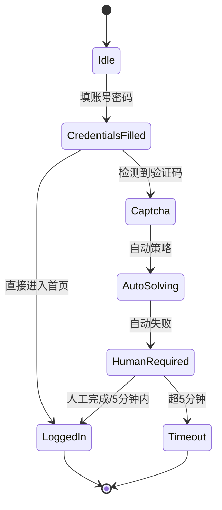
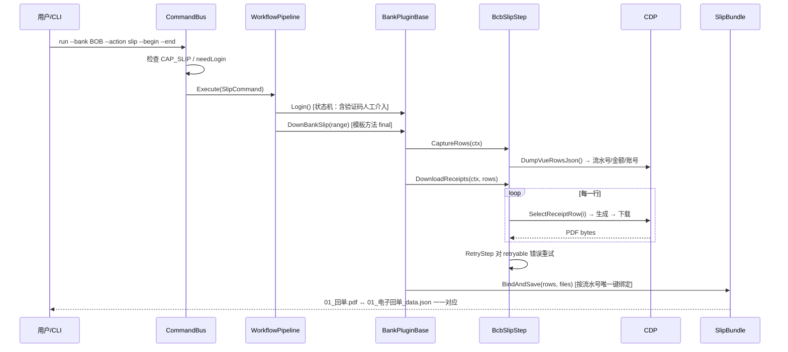

# NewRpa-Next 架构设计说明书

> 版本：v1.0 · 2026-11-26  
> 目标：在**不破坏现有可运行流程**（真实网银逐条下载、验证码人工介入、CDP 调试）的前提下，把工程从"能跑"演进到"可维护、可测试、可插拔"。

---

## 0. 设计目标与原则

| 目标     | 含义                                                |
| ------ | ------------------------------------------------- |
| 渐进式    | 新架构与旧代码可长期共存；每一步迁移都能独立编译、独立回滚                     |
| 单一职责   | 一个类只做一件事；BCB 的 3637 行上帝类按能力纵向切开                   |
| 显式错误   | 用 `Result<T>` 取代 `"" / false / 空 vector` 三种隐式失败信号 |
| 可替换    | 登录方式、验证码策略、取数方式、回单绑定都是可插拔策略                       |
| 可观测    | 每个步骤有名字、有耗时、有结果，日志统一格式，不靠到处 `spdlog::info`        |
| 不牺牲稳定性 | 保留已经被真实验证过的时序、重试 20s、弹窗兜底、人工 5 分钟看门狗              |

**原则**：模式是为解决问题服务的，不是为了炫技。本文每个模式都对应一个当前真实存在的痛点。

---

## 1. 现状诊断

| #  | 痛点      | 证据                                                                                       | 后果                           |
| -- | ------- | ---------------------------------------------------------------------------------------- | ---------------------------- |
| P1 | 上帝类     | `BCBPlugin.cpp` 3637 行，含 60+ 成员函数，登录/取数/回单/滑块/OCR/HID/状态全混在一起                            | 改一处崩全局，无法单测                  |
| P2 | 分发器膨胀   | `main.cpp` 里 12 个 `if (args.action == ...)` 分支，每个分支复制登录/配置/DLL 加载模板                      | 新增动作要改主控，违反开闭原则              |
| P3 | 错误语义混乱  | `Login()` 返回 `"ok"/"need_captcha"/错误信息`；`GetCurBal()` 失败返回空 vector；`FillInput()` 返回 bool | 调用方无法区分"没数据"和"出错了"           |
| P4 | 流程硬编码   | 演示版/查询版两套流程靠 `IsQueryVersion()` 在几十处分支切换                                                 | *新银行接入要复制整份插件*               |
| P5 | 重试与等待散落 | 20s 等待、3 次重试、轮末兜底、CDP 超时容错各写各的                                                           | 行为不一致，调参要改多处                 |
| P6 | 状态散落    | `loggedIn_`、`state/*.json`、Cookie 文件、增量日期各自管理                                            | 生命周期不清晰，调试困难                 |
| P7 | 资源释放靠手动 | `OnEvent`/`OffEvent`、`LoadLibrary`/`FreeLibrary`、Chrome 启停散落各函数                          | 异常路径容易泄漏，F5 调试曾被栈展开杀掉 Chrome |
| P8 | 数据绑定脆弱  | PDF 与 `04_电子回单_data.json` 靠*文件*名排序匹配                                                     | 异步下载会错位（第 3 行曾缺失）            |


---

## 2. 目标架构



**依赖方向**：上层依赖下层抽象，下层永不反向依赖上层。能力层之间互不依赖（OCR 不认识 CDP，HID 不认识银行）。

---

## 3. 设计模式总表

| 模式            | 解决的痛点                 | 落地位置                                                                             | 状态             |
| ------------- | --------------------- | -------------------------------------------------------------------------------- | -------------- |
| **抽象工厂**      | 插件 DLL 统一创建           | `PluginLoader` + `CreatePlugin/DestroyPlugin`                                    | ✅ 已有，保留        |
| **模板方法**      | P1/P4 流程骨架复用          | P4 落地为 `BCBPlugin` 固定公共流程 + `BcbVariant` 两个子类钩子；`arch::BankPluginBase` 保留为通用参考骨架 | 🆕 已落地         |
| **命令模式**      | P2 分发器膨胀              | `ICommand` + `CommandBus`                                                        | 🆕 新增          |
| **Result<T>** | P3 错误语义混乱             | `arch::Result<T>` + `Error`                                                      | 🆕 新增          |
| **策略模式**      | P4 登录/验证码/取数多实现       | `ICaptchaSolver` / `ITransactionExtractor` / `IDownloader`                       | 🆕 新增接口        |
| **责任链 / 装饰器** | P5 重试等待散落             | `WorkflowPipeline` + `RetryStep`                                                 | 🆕 新增          |
| **状态机**       | 登录多分支（验证码/UKey/人工/成功） | `LoginStateMachine`                                                              | 🆕 新增          |
| **Builder**   | P6 上下文构建复杂            | `AppContextBuilder`                                                              | 🆕 新增          |
| **RAII**      | P7 资源泄漏               | `ScopedEvent` / `ScopedTimer` / 现有 `ChromeLauncher`                              | 🆕 补充          |
| **观察者**       | CDP 事件推送              | `CDPSession::OnEvent/OffEvent`                                                   | ✅ 已有，加 RAII 包装 |
| **规格 / 映射器**  | P8 回单绑定               | `SlipBundle` + `ISlipBinder`                                                     | 🔧 抽象已有实现      |
| **单例**        | 全局 OCR 凭据             | `SetGlobalOcr/GlobalOcrCred`                                                     | ✅ 已有，保持收敛      |

---

## 4. 关键接口设计

### 4.1 Result<T> —— 统一错误通道

```cpp
namespace newrpa::arch {

struct Error {
    std::string code;       // "captcha.required" / "cdp.timeout" / "network.404"
    std::string message;    // 可展示给人的中文说明
    bool        retryable = false;
};

template <class T> class Result {
public:
    static Result Ok(T value);
    static Result Fail(Error e);
    bool ok() const;
    explicit operator bool() const { return ok(); }
    T&       value();       // 失败时抛 BadResultAccess
    const T& value() const;
    const Error& error() const;
};

// void 专用
using ResultVoid = Result<Void>;
inline ResultVoid MakeOk();
inline ResultVoid MakeFail(std::string code, std::string message,
                           bool retryable = false);

} // namespace newrpa::arch
```

**迁移规则**：`Login()` 从 `std::string` 改为 `Result<LoginOutcome>`；`GetHisTran()` 从 `vector` 改为 `Result<vector<Transaction>>`。旧接口先保留，新接口加 `Ex` 后缀并存一个版本。

### 4.2 命令模式 —— 消灭 main.cpp 的 if-else

```cpp
struct ICommand {
    virtual ~ICommand() = default;
    virtual std::string name() const = 0;                    // "slip" / "curbal"
    virtual uint32_t    requiredCaps() const = 0;            // CAP_SLIP 等
    virtual bool        needLogin() const { return true; }
    virtual Result<Void> execute(AppContext& ctx) = 0;
};

class CommandBus {
public:
    void Register(std::unique_ptr<ICommand> cmd);
    Result<Void> Execute(const std::string& name, AppContext& ctx);
    std::vector<std::string> List() const;
};
```

`main.cpp` 最终只保留：

```cpp
CommandBus bus;
bus.Register(std::make_unique<SlipCommand>());
bus.Register(std::make_unique<HisTranCommand>());
// ...
return bus.Execute(args.action, ctx).ok() ? 0 : 1;
```

**登录是横切关注点**：`CommandBus::Execute()` 统一检查 `needLogin()` 与 `requiredCaps()`，命令里不再写 `plugin->Login()`。

### 4.3 模板方法 —— 固定银行流程骨架

```cpp
class BankPluginBase : public IBankPlugin {
public:
    // final：子类不能改流程顺序
    std::vector<std::string> DownBankSlip(const DateRange& r) final {
        auto ctx = MakeExportContext(r);
        if (!Prepare(ctx)) return {};
        auto rows = CaptureRows(ctx);          // 钩子①：抓流水行
        auto files = DownloadReceipts(ctx, rows); // 钩子②：逐条下载
        return BindAndSave(ctx, rows, files);   // 钩子③：绑定落盘
    }

protected:
    virtual bool Prepare(ExportContext&) = 0;
    virtual std::vector<Transaction> CaptureRows(ExportContext&) = 0;
    virtual std::vector<DownloadedFile>
            DownloadReceipts(ExportContext&, const std::vector<Transaction>&) = 0;
    virtual std::vector<std::string>
            BindAndSave(ExportContext&, const std::vector<Transaction>&,
                        const std::vector<DownloadedFile>&); // 默认实现复用 SlipBundle
};
```

这样"导航→设日期→抓表→下载→绑定"的顺序对**所有银行一致**，银行差异只在三个钩子里。查询版/演示版的差异变成两个子类，不再靠 30 处 `IsQueryVersion()`。

### 4.4 策略模式 —— 可替换能力

```cpp
struct ICaptchaSolver {
    virtual ~ICaptchaSolver() = default;
    virtual bool CanSolve(const CaptchaKind k) const = 0;
    virtual Result<Void> Solve(CDPSession&, HidMouse*) = 0;
};

// 具体实现（可组合成责任链）：
//   AutoClickWordCaptchaSolver  —— 超级鹰 9800 + HID 点字
//   SliderCaptchaSolver         —— 顶象滑块轨迹算法
//   HumanCaptchaSolver          —— MessageBox + 5 分钟看门狗
//   NoCaptchaSolver             —— 空实现（演示版）
```

`CaptchaChain` 按优先级试：自动 → 失败 → 人工。当前 `LoginQuery()` 里那 200 行 if-else 就变成：

```cpp
auto r = captchaChain_->Solve(*session_, hidMouse_.get());
if (!r) return r.error();
```

### 4.5 状态机 —— 登录流程显式化



状态机的价值：把"什么时候该鸣笛""什么时候算成功""超时后怎么清理"从散落的布尔判断变成一个可打印、可回放的状态轨迹。

### 4.6 责任链 + 重试装饰器

```cpp
struct IWorkflowStep {
    virtual std::string name() const = 0;
    virtual Result<Void> run(AppContext&) = 0;
};

class RetryStep : public IWorkflowStep {
    int attempts_ = 3;
    std::chrono::milliseconds delay_{2000};
    // 只对 error.retryable == true 的错误重试
};

class WorkflowPipeline {
    void Add(std::unique_ptr<IWorkflowStep> step);
    Result<Void> Run(AppContext&);
};
```

回单逐条下载的"20s 等待 + 3 次重试 + 轮末兜底"统一用 `RetryStep` 表达，参数从配置读取，不再硬编码在 `DoQueryExportPerRow()` 里。

### 4.7 Builder + RAII

```cpp
auto ctx = AppContextBuilder()
    .WithBank(*bankCfg)
    .WithSession(session)
    .WithBrowser(browser)
    .WithOcr(GlobalOcrCred())
    .WithDownloadDir(fs::absolute("downloads"))
    .WithRetry(3, 20s)
    .Build();

// RAII 事件订阅：作用域结束自动 OffEvent
auto sub = ScopedEvent(session.get(), "Page.javascriptDialogOpening", cb);
// 不再需要手动配对 OffEvent，异常路径也安全
```

---

## 5. 目标目录结构

```
NewRpa-Next/
├─ app/
│  ├─ main.cpp                 # 只剩参数解析 + CommandBus
│  └─ commands/
│     ├─ LoginCommand.h/.cpp
│     ├─ SlipCommand.h/.cpp
│     ├─ HisTranCommand.h/.cpp
│     └─ AllAccountsCommand.h/.cpp
├─ core/
│  ├─ include/newrpa/
│  │  ├─ arch/                 # 🆕 架构基础设施（header-only）
│  │  │  ├─ Result.h
│  │  │  ├─ Command.h
│  │  │  ├─ Workflow.h
│  │  │  ├─ StateMachine.h
│  │  │  ├─ Strategy.h
│  │  │  ├─ Context.h
│  │  │  ├─ PluginBase.h
│  │  │  └─ Raii.h
│  │  ├─ cdp/ chrome/ net/ io/ ...  # 现有能力层
│  └─ src/
├─ plugins/
│  ├─ bcb/
│  │  ├─ BCBPlugin.cpp         # 瘦外壳：组装策略 + 模板方法钩子
│  │  ├─ steps/
│  │  │  ├─ BcbLoginStep.cpp   # 从 LoginQuery 拆出
│  │  │  ├─ BcbQueryStep.cpp   # 取数/日期/抓表
│  │  │  └─ BcbSlipStep.cpp    # 逐条回单
│  │  ├─ captcha/
│  │  │  ├─ SliderSolver.cpp
│  │  │  ├─ ClickWordSolver.cpp
│  │  │  └─ HumanSolver.cpp
│  │  └─ util/SliderMath.cpp   # 纯算法，可单测
│  ├─ icbc/ klb/
└─ docs/架构设计.md            # 本文
```

---

## 6. 核心数据流：回单逐条下载（迁移后）



关键点：**绑定发生在最后一步且基于流水号**，不再依赖下载顺序，从根本上解决第 3 行缺失/错位问题。

---

## 7. 迁移路线图（每阶段可独立编译、独立回滚）

| 阶段           | 内容                                                                                                                                                                                                        | 交付物               | 风险        |
| ------------ | --------------------------------------------------------------------------------------------------------------------------------------------------------------------------------------------------------- | ----------------- | --------- |
| **P0（本次）**   | 新增 `arch/` 基础设施头文件 + 本文；**不改任何现有 .cpp**                                                                                                                                                                   | 头文件 + 文档          | 极低        |
| **P1 ✅ 已完成** | `main.cpp` 接入 `CommandBus`，13 个 action 分支（含 all-account 别名共 14 条注册）迁入 `app/commands/`；日志文本、参数校验、Login 时机保持原样                                                                                              | 命令类               | 低         |
| **P2 ✅ 已完成** | 引入 `Result<T>` 并存接口 `IBankPluginEx` + `LegacyBankAdapter`（不改 DLL vtable，零 ABI 风险）；核心取数命令（登录/余额/流水/回单）切到 Ex 接口，保留旧接口回退                                                                                     | `arch/PluginEx.h` | 中         |
| **P3 ✅ 已完成** | 抽 `SliderVision` 纯视觉算法 + `DingXiangSliderSolver` 顶象策略；验证码拆成 `ChaojiyingClickWordSolver`（默认关闭）/`HumanClickWordSolver` 责任链，附 `BcbCaptchaArchAdapter` 桥接 P0 `arch::ICaptchaSolver`；BCBPlugin 减至 ~2740 行，行为不变 | 4 个策略源文件 + 宿主桥接   | 中         |
| **P4 ✅ 已完成** | `BCBPlugin` 成为模板方法宿主（登录检查 / data.json 解析 / CSV / 回单索引固定），查询版与演示版下沉为 `BcbQueryVariant` / `BcbDemoVariant` 两个子类；`IsQueryVersion` 分支全部移除，版本只在 `SetConfig` 决策一次                                               | 变体子类 + 3 个导出钩子    | 中高        |
| **P5 ✅ 已完成** | IBankPlugin 全部业务方法切到 Result<T>；删除 IBankPluginEx/LegacyBankAdapter（PluginEx.h 仅留兼容占位头）；3 个插件以 XxxImpl 保留原实现，命令层统一解包 | 最终形态 | 中（ABI 变更） |


**硬性要求**：每个阶段结束必须跑一次真实网银 `slip` 流程，确认回单数量与 `data.json` 行数一致，再进入下一阶段。

---

## 8. 测试与可观测性

- **纯算法单测**：`SliderMath`、`CsvLine`、`UTF-16BE CID 解码`、`SlipBundle::BuildIndex` 都是无浏览器依赖的纯函数，用最小测试框架即可覆盖。  
  |  |  |  
  | --- | --- |
- **流程日志**：`WorkflowPipeline` 每步输出 `[step] name=xxx elapsed=123ms result=ok|err`，失败时能一眼定位。
- **状态轨迹**：`LoginStateMachine` 提供 `Trace()` 返回状态迁移序列，人工介入问题可直接看到卡在哪一步。
- **回放**：`Result<Error>` 里带 `code`，配合 `sniff_result.json` 可离线复现接口问题。

---

## 9. 风险与取舍

1. **不追求全盘重写**：现有 BCB 流程经过真实网银验证，任何重构都可能引入时序回归。因此采用"新架构并行、旧代码逐步迁移"。
2. **模板方法 final 的代价**：将来若某银行流程确实不同，应新增钩子而不是放开 `final`，避免又一次失控分叉。
3. **`Result<T>` 的侵入性**：C++17 无 `std::expected`，自实现要保证移动语义正确；P2 阶段先在新接口使用，验证稳定后再全量切换。
4. **DLL ABI**：新增头文件全是 header-only 模板/内联，不改变现有导出符号，不影响 `libNewRpaCore.dll` 的二进制兼容性。
5. **人工介入不可自动化**：验证码人工环节保留 MessageBox + 5 分钟看门狗，状态机只做显式化，不改变交互方式。

---

## 10. 本次已落地的文件

- `core/include/newrpa/arch/Result.h` —— 统一错误通道
- `core/include/newrpa/arch/Command.h` —— 命令模式 + CommandBus
- `core/include/newrpa/arch/Workflow.h` —— 责任链 + 重试装饰器
- `core/include/newrpa/arch/StateMachine.h` —— 登录状态机
- `core/include/newrpa/arch/Strategy.h` —— 验证码/取数/回单策略接口
- `core/include/newrpa/arch/Context.h` —— AppContext + Builder
- `core/include/newrpa/arch/PluginBase.h` —— 模板方法基类
- `core/include/newrpa/arch/Raii.h` —— ScopedEvent / ScopedTimer
- `core/include/newrpa/arch/all.h` —— 汇总头
- `docs/examples/BCBPluginV2.skeleton.h` —— BCB 向新架构迁移的可编译骨架
- `tools/arch_selftest.cpp` —— 架构层语法自检样例
- `app/commands/BankCommands.h/.cpp` —— P1 落地的 14 条银行业务命令（命令总线工厂）
- `core/include/newrpa/arch/PluginEx.h` —— P5 后仅保留兼容占位头；`IBankPluginEx`/`LegacyBankAdapter` 已删除
- `plugins/bcb/strategy/BcbStrategy.h` —— P3 宿主能力接口、滑块/验证码策略与责任链声明
- `plugins/bcb/strategy/SliderVision.h/.cpp` —— 顶象缺口识别纯视觉算法（GDI+ 解码、形状掩膜、Sobel/暗区融合）
- `plugins/bcb/strategy/DingXiangSlider.cpp` —— 滑块一轮尝试：标定、拟人轨迹、同向逼近、结果判定
- `plugins/bcb/strategy/ClickWordCaptcha.cpp` —— 点选检测、超级鹰自动点字、5 分钟看门狗人工介入
- `plugins/bcb/variant/BcbVariant.h/.cpp` —— P4 查询版/演示版两个子类，封装 4 个差异步骤

> P0/P2 的基础设施为纯新增头文件，不参与现有编译单元的语义改变；P3 新增策略 `.cpp` 并改写 BCBPlugin 的调用点，但逐字保留算法、日志与失败原因字符串，行为等价。

### 验证状态（2026-11-26）

- `g++ -std=c++17 -fsyntax-only`：架构自检样例、BCB 迁移骨架均通过。
- `cmake --build build-mingw --parallel 4`：`NewRpaCore`、3 个银行插件、`newrpa` 等 8 个目标全部构建成功，**无回归**。
- P1 完成后重新全量构建通过：`newrpa.exe` 链接成功，3 个银行插件与核心库无回归；`--help` 与 `list` 命令实测正常。
- P2 完成并全量构建通过；架构自检样例（含适配器空指针/LoginOutcome 验证）退出码 0。
- 迁移进度：**P0–P5 全部完成**。
- P1 兼容措施：`CommandBus::SetAutoLogin(false)`（默认），命令仍自行调用 `Login()`；`Unknown action`、`--begin and --end required`、`Plugin doesn't support login` 等原有日志文本逐字保留。
- P2 兼容措施：`IBankPluginEx` 为阶段性并存接口，P5 已完成历史使命并移除；`IBankPlugin` 现在直接返回 `Result<T>`。
- P5 兼容措施：`LoginOutcome.raw` 保留 `ok`/`already logged in`/原始错误信息，`Login result: {}`、`[SNIFF] Login: {}`、`[HTTP-SESSION] Login: {}` 等日志文本不变；三个插件的旧实现改名为 `XxxImpl`，仅由 `Result<T>` 包装层转发，业务逻辑与失败原因字符串零改动。
- P5 验证：32 位语法检查覆盖命令层/主控/自检/3 个插件；64 位 `build-mingw` 全量构建通过；架构自检退出码 0；`--help` 与 `list` 实测正常，3 个插件均加载。
- P3 兼容措施：验证码责任链默认只注册人工策略，自动点字策略虽已实现但 `enableAuto=false`，保持「文字点选验证码直接转人工」的既定行为；`DetectClickWordCaptcha`/`WaitHumanClickCaptcha`/`SliderAttempt` 的日志与返回字符串原样保留。
- P3 同时把 `SkKeyBoard` 残留引用统一为 `HidKeyBoard`（BCB/KLB 的 include、CMake 源文件、日志文本），与用户侧改名保持一致。
- 工具链核查：环境无 `make.exe`，但 `mingw32-make.exe` 在 `E:/Workdaddy/mingw64/bin` 且为 `build-mingw` 缓存指定程序；`cmake` 4.4.4 存在（PATH 与 `E:/Workdaddy/mingw32/mingw32/bin` 各一份）。64 位 `build-mingw` 与 32 位临时验证构建均全量通过。
- P4 兼容措施：变体在 `SetConfig` 时按有效 loginUrl 决策一次；空 URL 与旧 `Login()` 默认 URL 一样按演示版处理。路由常量、`tag`、回单 `BCB_SLIP_MODE` 逐条/批量逻辑与日志逐字保留；`IsQueryVersion` 已从插件中完全移除。

### slip 真机回归（2026-11-26 18:38，未通过——环境限制）

- 信任区排查：腾讯电脑管家主进程/服务/自启项均不存在，Chrome 由 `newrpa.exe` 正常拉起且 CDP 9222 正常响应——**秒退拦截问题当前已不存在**。
- 登录与取数：滑块自动通过、查询版登录成功、日期设置与抓表成功（4 行数据写入 data.json/fields.json）。
- 下载失败：4 行逐条下载 + 批量回退均为 0 文件，全系统无新 PDF/DLZ 落盘。根因是 `newrpa.exe` 运行在 **Low Mandatory Level（沙箱降权令牌）**，`Browser.setDownloadBehavior` 的原生下载落盘被拦截（此前"取消置顶脚本沙箱跨进程写失败 err=1400"是同类限制）。
- 结论：与信任区、与 P1/P2 代码改动均无关；同一份代码在 11-24 普通终端跑通过并有 PDF 落盘。**需在普通权限终端重新跑 slip 回归**，并核对回单数与 data.json 行数（应为 4）。
